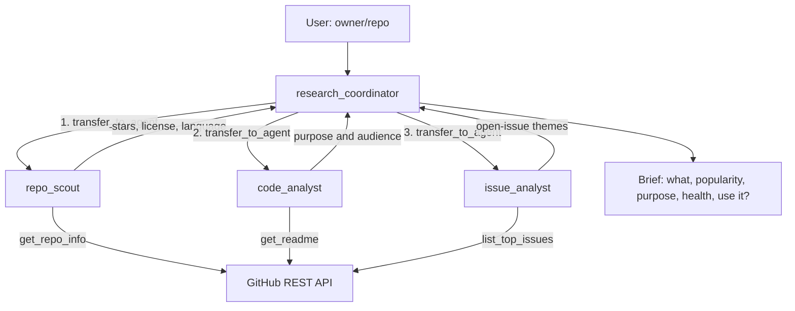
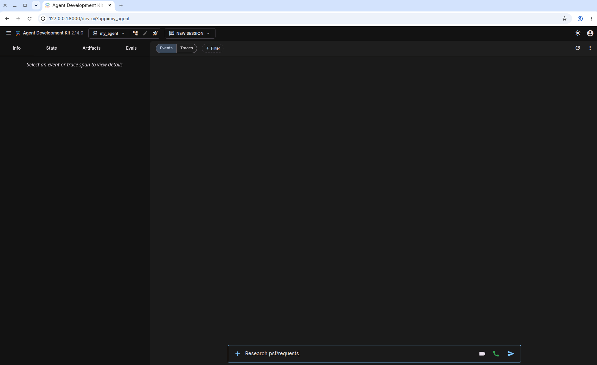
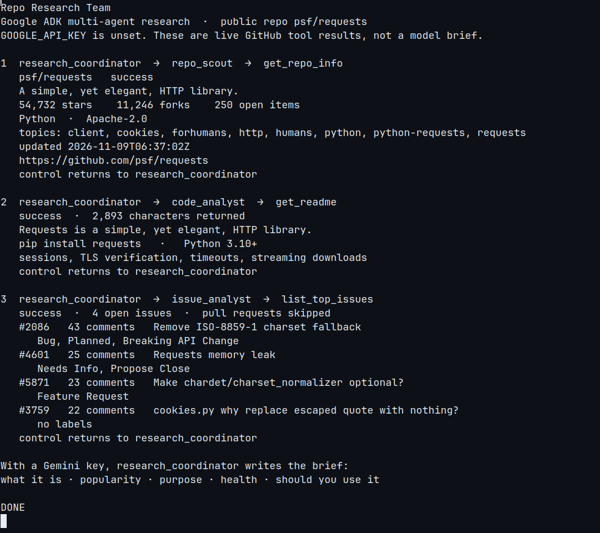

# Repo Research Team

A Google ADK team that turns a public `owner/repo` into a short “should you use it?” brief from live GitHub data.

## What it does

You name a public repository. `research_coordinator` hands the question to three specialists, in order. Each one calls one GitHub REST tool and returns a summary. The coordinator then writes a brief: what it is, popularity, purpose, issue health, and whether to use it. If `owner/repo` is missing, it asks once.

The model is `gemini-3.1-flash-lite`. The tools talk to `https://api.github.com` and work for public repos without a token.

## Architecture

ADK gives the coordinator a `transfer_to_agent` tool whose names are limited to the sub-agents below. The coordinator is instructed to hand off in this order. Each specialist runs, then control comes back for the next handoff. The coordinator writes the brief only after all three have reported.



| Agent | Job | Tool |
| --- | --- | --- |
| `research_coordinator` | Routes the handoffs and writes the brief | — |
| `repo_scout` | Stars, forks, license, language, topics | `get_repo_info` |
| `code_analyst` | What the project is for, from the README | `get_readme` |
| `issue_analyst` | Themes in the most-discussed open issues | `list_top_issues` |

`list_top_issues` asks for open items sorted by comment count, then drops pull requests. GitHub’s `open_issues_count` still includes pull requests, so the two numbers differ.

## Setup

Python 3.12+.

```bash
git clone https://github.com/hassan2314/Team-Agent.git
cd Team-Agent
python -m venv .venv
source .venv/bin/activate
pip install -r requirements.txt
cp my_agent/.env.example my_agent/.env
```

Put real keys in `my_agent/.env` only. That file is gitignored. Placeholders live in [`my_agent/.env.example`](my_agent/.env.example):

| Variable | Required | Purpose |
| --- | --- | --- |
| `GOOGLE_API_KEY` | One of the Gemini keys | Gemini API key. Wins if both Gemini keys are set. |
| `GEMINI_API_KEY` | One of the Gemini keys | Alternate name for the same Gemini key. |
| `GITHUB_TOKEN` | No | Classic PAT. Public reads work without it; a token raises the rate limit. |
| `GROQ_API_KEY` | No | Unused by these agents. |

Create a Gemini key at [Google AI Studio](https://aistudio.google.com/apikey).

## How to run

From the project root, with the virtualenv active:

```bash
adk web --port 8000 --reload_agents
```

Open [http://127.0.0.1:8000](http://127.0.0.1:8000), select `my_agent`, and ask:

```text
Research psf/requests
```

Other prompts: `Research fastapi/fastapi`, `Give me a brief on pallets/flask`.

The first `adk` launch in a terminal asks whether to send usage telemetry. Answer `n` to decline. The Dev UI asks once as well; **No Thanks** leaves it off.

A single-shot CLI run uses the same agent:

```bash
adk run my_agent "Research psf/requests"
```

That call needs `GOOGLE_API_KEY` or `GEMINI_API_KEY`. Without one, ADK stops before the model with `No API key was provided.`



## Sample output

No Gemini API key was available in this environment, so the coordinator model did not write the brief below. On 9 November 2026 the three tools were run live against the public repo [`psf/requests`](https://github.com/psf/requests). The log is the real handoff. The brief under it is an example of the shape the coordinator is instructed to produce, written for this README from those tool results.



`get_repo_info` returned success: **54,732** stars, **11,246** forks, **250** open items (issues and pull requests), Python, Apache-2.0, updated `2026-11-09T06:37:02Z`. Description: “A simple, yet elegant, HTTP library.”

`get_readme` returned **2,893** characters. The README describes Requests as an HTTP library for Python 3.10+, installed with `pip install requests`, with sessions, TLS verification, timeouts, and streaming downloads.

`list_top_issues` returned **4** open issues after skipping pull requests:

| Issue | Comments | Labels |
| --- | --- | --- |
| [#2086](https://github.com/psf/requests/issues/2086) Remove ISO-8859-1 charset fallback | 43 | Bug, Planned, Breaking API Change |
| [#4601](https://github.com/psf/requests/issues/4601) Requests memory leak | 25 | Needs Info, Propose Close |
| [#5871](https://github.com/psf/requests/issues/5871) Make chardet/charset_normalizer optional? | 23 | Feature Request |
| [#3759](https://github.com/psf/requests/issues/3759) cookies.py why replace escaped quote with nothing? | 22 | — |

**Example brief (written for this README, not by the model)**

- **What it is.** Requests, a Python HTTP library under Apache-2.0.
- **Popularity.** 54,732 stars and 11,246 forks, with metadata updated the same day as this run.
- **Purpose.** Everyday HTTP for Python 3.10+: sessions, TLS verification, timeouts, streaming.
- **Health.** The busiest open issues are a planned charset-fallback change, a memory-leak report already labeled Propose Close, an optional-dependency request, and a cookie-quoting question.
- **Should you use it?** Yes for ordinary Python HTTP clients. The open threads are long-running API questions, and the repo metadata was updated on the day of the run.

## Tests

```bash
pip install -r requirements-dev.txt
pytest -q
```

GitHub Actions runs the same lint and tests on Python 3.12.

## Layout

```text
my_agent/
├── agent.py            # research_coordinator and three specialists
├── .env.example
└── tools/
    └── github_tools.py # get_repo_info, get_readme, list_top_issues
```
